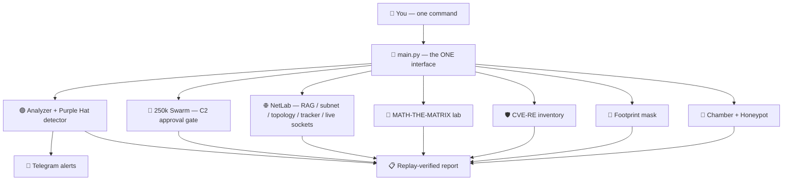
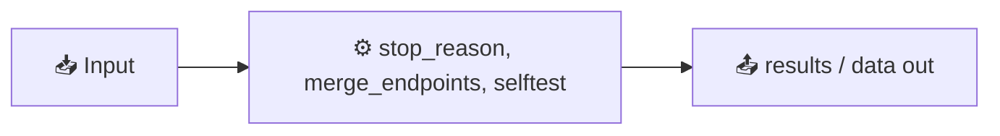
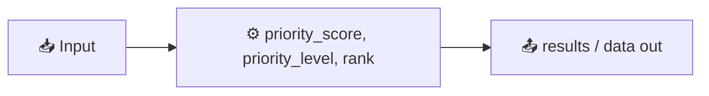
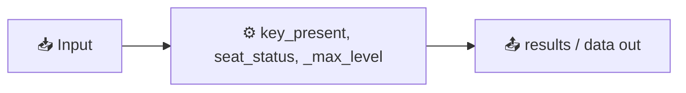
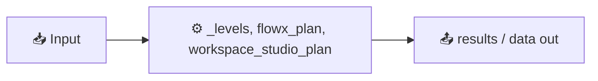
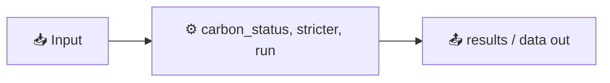
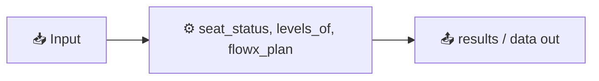
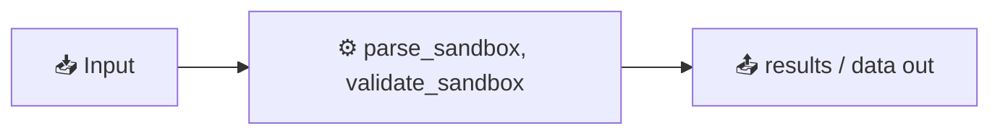
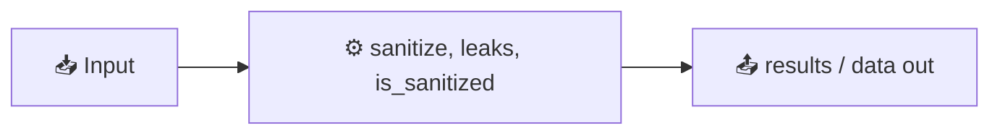

# ⚡ A-C-D-Matrix-FORCE

**🟣 Accurate Cyber Defense's Network Analyzer + Purple Hat Bot, fused with 🌐 LLM-X-NetLab, 🧮 MATH-THE-MATRIX, 🛡️ CVE-RE, 👣 sysadmin-footprint-mask, and the 🧪 sandbox-api + 🐝 honeyroot-x Docker images — one force, one interface, zero dependencies.**

Created by **Darion Kellar** · Upstream credit: Accurate Cyber Defense (Malawi 🇲🇼), Purple Hat Bot by Ian Carter Kulani

## 🏷️ Updated Workflows & Tech Stack Badges

[](https://github.com/credkellar/A-C-D-Matrix-FORCE/actions/workflows/ci.yml)
[](https://github.com/credkellar/A-C-D-Matrix-FORCE/actions/workflows/docker-publish.yml)

> ℹ️ Workflow badges are static shields linked to the real Actions pages (the
> live `badge.svg` status URLs only light up after the two workflow files are
> pasted into `.github/workflows/` and run once — that paste is a listed
> install step below, not a hidden gap.)

### 🧰 Tech Stack


**Stack in words:** 🐍 Python 3.10+ (standard library ONLY) · 🐳 Docker · ⚙️ GitHub Actions (CI + Docker Publish) · 📨 Telegram Bot API · 📊 Chart.js (dashboard) · 🧪 pytest · 🐚 Bash (sysadmin bin scripts)

## 📖 What is this about?

This is about **one security lab that used to be eight separate projects**.

- 🟣 Two tools from **Accurate Cyber Defense** — a network **Analyzer** that could *see* packets but not judge them, and a **Purple Hat Bot** that could *judge* traffic but not explain it — merged first (v1.0.0).
- 🐝 Then a **250k agent swarm** architecture from a Gemini spec video (v1.1.0).
- 🗜️ Then four of Darion's own repos were **decompressed** into it — expanded to their full source trees, **duplicates removed, everything different kept** (v1.2.0–v1.3.0, audit in `docs/DEDUPE_MAP.md`).
- 🧪 Finally the **sandbox-api** detonation chamber and the **honeyroot-x honeypot** were merged in from his Docker Hub images (v1.4.0) — and the whole force got its name: **A-C-D-Matrix-FORCE**.

Every source is preserved verbatim (sha256-checked) inside the project, every feature is reachable from **one** `main.py`, and the whole thing is verified: **129 pytest passed · unified CHECKS 47/47** (observed 2026-11-08).

## 🎯 What this does?

- 🔍 **Dissects packets** — protocol details, hex dump, and disassembly for TCP/UDP/ICMP/ARP/HTTP/HTTPS/FTP/DNS/SMTP and more
- 🚨 **Detects threats** — port scans, DoS, and HTTP floods at the Purple Hat Bot's exact upstream thresholds (10 / 100 / 50 per minute, 300 s cooldown)
- 📨 **Alerts on Telegram** — using the bot's own config file format, token never printed or logged
- 🐝 **Runs a 250k virtual agent swarm** — C2 human-in-the-loop approval, telemetry pipeline, replay-verified findings escalated to humans
- 🌐 **Teaches + computes networking** — RAG tutor over 21 networking notes, subnet calculator, topology simulator with SPOF analysis, OSI layer mapper, device advisor
- 🛰️ **Tracks IPs** — hopper/tracker/mapper (START → MIDDLE → END), Google Earth KML export, live DNS / connect / HTTP / geo, and a beyond-the-END endpoint walker
- 🧮 **Tests formulas + inventions** — 56 formulas across 24 domains, 46 candidates, 2048+ test battery, sandbox-only promotion
- 🛡️ **Inventories real vulnerabilities** — 44 unauthenticated RCE / memory-disclosure records with priority ranking (records are data, never exploit code)
- 👣 **Masks your own footprint** — sanitizes env/history traces on your own machine, with isolation + profile + sandbox validation
- 🧪 **Detonates safely** — Sandbox-API chamber triages samples **statically** (never executes, network always off); honeypot module classifies recorded trap attempts (**no listener exists**)
- 🧠 **Asks a council** — one `council` surface reporting all SIX seats (names-only, no live calls) — v1.5.0: the Purple Hat core and the chamber/honeypot seat carry Carbon 4 + Muse + Flows too, so every part of the Force has the full council

## 🧠 How this works?



**The pipeline, step by step:**

1. 📥 **Input** — packets (simulated, supplied, or live), questions, formulas, CVE records, session envs, or code samples enter through `main.py`.
2. ⚙️ **Engines** — each namespace runs its own verbatim engine: dissection + detection, swarm telemetry, NetLab's RAG + live sockets, the Matrix battery, CVE ranking, footprint sanitizing, chamber triage.
3. 🧠 **Council + gates** — Carbon 4 / Muse seats review inside their labs; HOLD gates stay down for live exploitation, real deployment, clinical use, wiping system logs, opening a honeypot listener, and the rest — only Darion lifts one, per action.
4. ✅ **Verification** — swarm findings must *reproduce* in a fresh detector before escalation; every lab ships its own checks and they all run in the one test suite.
5. 📤 **Output** — reports (JSON/CSV), Telegram alerts, KML maps, flow plans, and a single CHECKS verdict.

## 😎 Why is this cool?

Because eight projects became **one force** without losing a single different feature — and the receipts (hashes, tests, live image pulls) are all in the repo.

### 🔟 10 reasons why this is cool

1. 🟣➡️⚡ **Sight + judgement in one pipeline** — the Analyzer's eyes and the Purple Hat's brain finally share one packet stream.
2. 🐝 **A 250,000-bot swarm that fits in a folder** — virtual, labelled, honest — and its findings are replay-verified before a human ever sees them.
3. 🗜️ **Decompression without bloat** — four repos expanded verbatim, and the three true duplicates (ping, scan, traceroute) exist exactly **once**.
4. 🧠 **Four councils, one door** — every lab keeps its own Carbon 4 + Muse engine (different code, different subjects), reported through a single `council` command.
5. 🧪 **A detonation chamber that never detonates** — sandbox-api's triage with `executed=False` on every report, by design.
6. 🍯 **A honeypot with no listener** — honeyroot-x's trap *log analysis* merged; the bait never grants access and nothing binds a port.
7. 🛰️ **From a packet to the whole internet path** — dissect one packet, then track START → MIDDLE → END and keep walking past the end until a hop won't answer.
8. 🪶 **Zero dependencies** — eight projects, ~75 scripts, and `pip install` has nothing to do. It runs on a phone with Termux.
9. 🔐 **HOLD gates that mean it** — `main.py --hold-demo` exits 2; wiping logs, live exploitation, and real deployment stay down until Darion lifts them one by one.
10. 📦 **Provenance you can check** — upstream originals byte-preserved, vendored packages sha256-verified, both Docker images live on the Hub (sandbox-api **8,467 pulls**, honeyroot-x **325 pulls**).

## 🧩 What problems this solves?

| # | 😖 Problem | ✅ Solution |
|---|---|---|
| 1 | The Analyzer showed packets but detected nothing | **Purple Hat detector on the same stream** — dissection and detection in one report |
| 2 | The Bot detected threats but had no packet evidence | **Hex/disassembly attached** — every alert can be traced to dissected packets |
| 3 | Eight separate repos = eight CLIs, eight READMEs, eight setups | **ONE `main.py`** — every feature is one command away |
| 4 | The same features (ping/scan/trace, councils) copied in every project | **Deduped once, kept as data** — canonical live engines + the bot's port list as a profile (full audit: `docs/DEDUPE_MAP.md`) |
| 5 | "250k bots" claims are usually pure theatre | **Virtual fleet, labelled, with real verification** — findings must replay in a fresh detector to escalate |
| 6 | Sandbox tools that execute the sample are a risk themselves | **Static-only chamber** — triage reports carry `executed=False`, `network=0`, always |
| 7 | Honeypots expose the host they run on | **Log-analysis honeypot** — classification + threat scoring of recorded attempts, no listener code exists |
| 8 | Security notes and knowledge scattered across projects | **NetLab RAG tutor** — 21 networking notes, searchable, with subnet/topology/layer engines that compute |
| 9 | CVE data scattered across vendor advisories | **CVE-RE inventory** — 44 records, one ranking, remediation status per record |
| 10 | Your own shell leaks who/where you are (history, SSH vars) | **Footprint mask** — sanitizer + profile + isolation checks for your own machine, with audit-trail actions held |

## ⌨️ Commands

```bash
python main.py                      # demo + full unified checks
python main.py demo                 # analyzer + detector + swarm-telegram demo
python main.py analyze              # simulated capture: list, dissect, stats
python main.py packet 0             # details + hex + disassembly for one packet
python main.py simulate portscan 203.0.113.9 192.168.1.50
python main.py ping <host>          # canonical LIVE ping (NetLab engine, method labelled)
python main.py scan <host>          # canonical LIVE scan · add --profile bot15 for the bot's 15 ports
python main.py trace <host>         # LIVE traceroute -> START/MIDDLE/END tracker
python main.py shell                # the Purple Hat Bot's own command shell
python main.py swarm plan           # 250k swarm: C2 plan (executes nothing)
python main.py swarm run --approve  # human-approved swarm cycle
python main.py swarm fuzz           # invariant fuzzing of the dissector
python main.py ask "What does a router do?"   # NetLab orchestrator (RAG + council)
python main.py subnet 192.168.1.0/24 · topology star 6 · layer router · device "connect two buildings"
python main.py track 192.168.1.1,203.0.113.10 · earth <ips> · flow "star topology" · quiz · bench · stages
python main.py connect <host> <port> · dns <host> · http <url> · geo <ip> · walk --selftest
python main.py netlab checks        # NetLab's own 23 self-checks
python main.py matrix report        # MATH-THE-MATRIX: formulas + 2048 battery + gates
python main.py cve report           # CVE-RE: inventory report + its checks
python main.py cve catalog          # every CVE record
python main.py mask checks          # sysadmin-footprint-mask: its full 36 checks
python main.py mask sanitize        # sanitize the sample env (demo)
python main.py chamber demo         # Sandbox-API chamber: 15 triaged, never executed
python main.py chamber triage sqli-01
python main.py honeypot report      # honeypot log analysis: 12 attempts, top threat 100
python main.py council              # ONE council status — all SIX seats
python main.py brain status         # Purple Hat core seats (Carbon 4 + Muse + Flows)
python main.py brain review         # core council review of a demo DoS alert set
python main.py --hold-demo          # every lab's HOLD gates (exit 2)
python main.py checks               # unified CHECKS (44/44 at last verified run)
```

## 🚀 How to install this?

### Step-by-step

1. 📥 **Clone it** — `git clone https://github.com/credkellar/A-C-D-Matrix-FORCE.git`
2. 📂 **Enter the folder** — `cd A-C-D-Matrix-FORCE`
3. 🐍 **Check Python** — `python3 --version` (needs 3.10 or newer)
4. 🎉 **Install nothing** — there are zero dependencies. (For the test suite only: `pip install pytest`)
5. ▶️ **Run the demo** — `python main.py demo`
6. ✅ **Run the checks** — `python main.py checks` → expect `CHECKS 47/47 · VERDICT PROCEED`
7. 🧪 **Run the tests** — `python -m pytest -q` → expect `129 passed`
8. 🖥️ **Open the dashboard** — open `dashboard/network-analyzer.html` in any browser
9. 📨 **(Optional) Telegram alerts** — create a bot with BotFather, then in `python main.py shell`: `config_telegram token <VALUE>` and `config_telegram chat_id <VALUE>` (the token is never printed or committed)
10. 🐳 **(Optional) Docker** — `docker build -t a-c-d-matrix-force .` then `docker run --rm a-c-d-matrix-force`
11. 🚀 **(Publishing, owner steps)** — paste `ci.yml` + `docker-publish.yml` into `.github/workflows/`, add `DOCKERHUB_USERNAME` + `DOCKERHUB_TOKEN` secrets to this repo, and the first push publishes `credkellar/a-c-d-matrix-force:latest`

## 📋 Requirements?

- 🐍 **Python 3.10 or newer** — that's it for running everything
- 📦 **Zero runtime dependencies** — standard library only, across all ~75 scripts
- 🧪 **pytest** — only if you want to run the test suite (dev tool)
- 🌐 **Network** — only for the live commands (`ping/scan/trace/dns/http/geo/walk`), Telegram alerts, and Docker publishing; everything else runs fully offline
- 🐳 **Docker** — optional, for the container image
- 📨 **Telegram account** — optional, only for alert delivery
- 💻 **Any OS** — Windows, Linux, macOS, and Android/Termux (the live-socket results are real on your own network; in restricted sandboxes ICMP may fall back to labelled TCP timing)

## 🧒 Explain in 5th grade English

Imagine you have a **mail room** 📬. Every letter that comes in is a "packet."

- 🟣 The **Analyzer** is a worker who opens each letter and reads it out loud: who sent it, where it goes, and what the secret codes inside mean.
- 🎩 The **Purple Hat Bot** is the guard. If one person sends way too many letters, or knocks on every door in the building, the guard shouts "hey, that's suspicious!" — and can text you on Telegram 📱.
- 🐝 The **Swarm** is a pretend army of 250,000 tiny helpers. They are not real robots — they are names on a list — but the work they check is real, and a finding only counts if it happens **twice**.
- 🌐 **NetLab** is the teacher. It answers questions about networks and draws maps of where letters travel: start, middle, end.
- 🧮 The **Matrix lab** is a homework-checking machine for math ideas — it tests thousands of answers before believing any of them.
- 🛡️ The **CVE list** is a wall of "known broken locks" so you can fix yours first.
- 👣 The **Footprint Mask** helps you clean your own footprints off your own floor — and it refuses to touch anyone else's house.
- 🧪 The **Chamber** looks at suspicious toys through thick glass. It **never** turns them on.
- 🍯 The **Honeypot** is a fake cookie jar. Bad visitors touched it in the past; we study their fingerprints. The jar is not on your table now — nobody can grab it.

One box 📦, one remote control (`main.py`), no batteries to buy (zero dependencies).

## 🗺️ Mermaid flowchart diagrams — every script

One master diagram lives in **How this works?** above. Here is one flowchart **per script** (84 scripts):

### 🐍 `beyond_end.py`

LLM-X-NetLab — BEYOND THE END POINT.



### 🐍 `conftest.py`

Python module.


### 🛡️ `cve_re/__init__.py`

CVE-RE -- static, synthetic, defensive CVE reverse-engineering lab.


### 🛡️ `cve_re/analyzer.py`

Deterministic risk / priority triage over the CVE catalog.



### 🛡️ `cve_re/carbon4.py`

Gemini Carbon 4 Extended Thinking -- DECIDER seat (offline).



### 🛡️ `cve_re/catalog.py`

CVE catalog -- data only, never exploit code.


### 🛡️ `cve_re/flows.py`

Google Flows -- ALL FOUR flows, plan-only.



### 🛡️ `cve_re/gates.py`

HOLD gates -- anything live is held, never executed by this lab.


### 🛡️ `cve_re/pipeline.py`

Pipeline + self-checks for CVE-RE (offline, deterministic).


### 👣 `footprintmask/__init__.py`

sysadmin-footprint-mask — local SysAdmin mask + digital footprint sanitizer.


### 👣 `footprintmask/blackbox.py`

⛓️ Hash-chain blackbox log — every plan and verdict is chained.


### 👣 `footprintmask/brains.py`

🧠 Brains — HOLD gates.


### 👣 `footprintmask/carbon4.py`

🧠 Gemini Carbon 4 Extended Thinking — merged brain layer.



### 👣 `footprintmask/flows.py`

🌊 All the Google flows, merged — one registry, one merged plan.



### 👣 `footprintmask/freeai.py`

🤖 freeai — provider seat registry, NAMES ONLY.


### 👣 `footprintmask/isolation.py`

🔒 Secure execution wrapper — the Python model of bin/secure-exec.


### 👣 `footprintmask/profile.py`

📜 Shell profile rules — the model of configs/profile.d/footprint-mask.sh.


### 👣 `footprintmask/sandbox.py`

🐳 Ephemeral Docker sandbox — the model of Dockerfile.sandbox.



### 👣 `footprintmask/sanitizer.py`

🧹 Environment sanitizer — the Python model of bin/sanitize-env.



### 🌐 `llmx_netlab/__init__.py`

LLM-X-NetLab: the LLM-x architecture diagram merged with the computer

```mermaid
flowchart LR
    A["📥 Input"] --> B["⚙️ module code"]
    B --> C["📤 results / data out"]
```

### 🌐 `llmx_netlab/backbone.py`

LLM core backbone (poster block 3), honestly staged.

```mermaid
flowchart LR
    A["📥 Input"] --> B["⚙️ BigramSLM"]
    B --> C["📤 results / data out"]
```

### 🌐 `llmx_netlab/brains/__init__.py`

Python module.

```mermaid
flowchart LR
    A["📥 Input"] --> B["⚙️ module code"]
    B --> C["📤 results / data out"]
```

### 🌐 `llmx_netlab/brains/carbon4.py`

Gemini Carbon 4 Extended Thinking — the DECIDER seat.

```mermaid
flowchart LR
    A["📥 Input"] --> B["⚙️ Carbon4"]
    B --> C["📤 results / data out"]
```

### 🌐 `llmx_netlab/brains/council.py`

The council: Carbon 4 decides, Muse advises, strictest wins.

```mermaid
flowchart LR
    A["📥 Input"] --> B["⚙️ Council"]
    B --> C["📤 results / data out"]
```

### 🌐 `llmx_netlab/brains/muse.py`

Muse (Meta Model API) — the ADVISOR seat. Names-only, never overrides.

```mermaid
flowchart LR
    A["📥 Input"] --> B["⚙️ MuseAdvisor"]
    B --> C["📤 results / data out"]
```

### 🌐 `llmx_netlab/domain.py`

Domain-specific modules — the 'X' integrations (poster block 6).

```mermaid
flowchart LR
    A["📥 Input"] --> B["⚙️ code_interpreter, transfer_time, analyse_link"]
    B --> C["📤 results / data out"]
```

### 🌐 `llmx_netlab/earth.py`

Google Earth seat — KML export for a tracked path.

```mermaid
flowchart LR
    A["📥 Input"] --> B["⚙️ build_kml"]
    B --> C["📤 results / data out"]
```

### 🌐 `llmx_netlab/embeddings.py`

Embedding model seat: from-scratch TF-IDF vectors + cosine similarity.

```mermaid
flowchart LR
    A["📥 Input"] --> B["⚙️ TfidfEmbedder, cosine"]
    B --> C["📤 results / data out"]
```

### 🌐 `llmx_netlab/flowvideo.py`

Google Flow seat — explainer-video PLANNING for networking topics.

```mermaid
flowchart LR
    A["📥 Input"] --> B["⚙️ plan_video"]
    B --> C["📤 results / data out"]
```

### 🌐 `llmx_netlab/gateway.py`

Multi-modal gateway & input processing (poster block 2).

```mermaid
flowchart LR
    A["📥 Input"] --> B["⚙️ tokenize, Vocabulary, describe_media"]
    B --> C["📤 results / data out"]
```

### 🌐 `llmx_netlab/guardrails.py`

Guardrails & monitoring (poster block: support & safety layer).

```mermaid
flowchart LR
    A["📥 Input"] --> B["⚙️ safety_filter, redact_pii, LatencyMonitor"]
    B --> C["📤 results / data out"]
```

### 🌐 `llmx_netlab/iphop.py`

IP address HOPPER, TRACKER and MAPPER.

```mermaid
flowchart LR
    A["📥 Input"] --> B["⚙️ analyse_hop, track_path, track_topology"]
    B --> C["📤 results / data out"]
```

### 🌐 `llmx_netlab/kb.py`

Computer-networking knowledge base, distilled from the handwritten

```mermaid
flowchart LR
    A["📥 Input"] --> B["⚙️ all_entries, entry_by_id, corpus_text"]
    B --> C["📤 results / data out"]
```

### 🌐 `llmx_netlab/live.py`

Live networking — real sockets, online at Darion's direction (v1.1.0).

```mermaid
flowchart LR
    A["📥 Input"] --> B["⚙️ dns_lookup, tcp_connect, port_scan"]
    B --> C["📤 results / data out"]
```

### 🌐 `llmx_netlab/memory.py`

Memory systems (poster block 5).

```mermaid
flowchart LR
    A["📥 Input"] --> B["⚙️ SessionMemory, EpisodicMemory"]
    B --> C["📤 results / data out"]
```

### 🌐 `llmx_netlab/mlops.py`

MLOps & continuous learning (poster block: support layer).

```mermaid
flowchart LR
    A["📥 Input"] --> B["⚙️ run_benchmark, FeedbackLog"]
    B --> C["📤 results / data out"]
```

### 🌐 `llmx_netlab/netlab.py`

The NetLab engines: real networking math + OFFLINE simulation.

```mermaid
flowchart LR
    A["📥 Input"] --> B["⚙️ ip_class, subnet_info, build_topology"]
    B --> C["📤 results / data out"]
```

### 🌐 `llmx_netlab/orchestrator.py`

Agentic orchestrator & planner (poster block 1).

```mermaid
flowchart LR
    A["📥 Input"] --> B["⚙️ Orchestrator"]
    B --> C["📤 results / data out"]
```

### 🌐 `llmx_netlab/rag.py`

Retrieval-Augmented Generation system (poster block 4).

```mermaid
flowchart LR
    A["📥 Input"] --> B["⚙️ RagSystem"]
    B --> C["📤 results / data out"]
```

### 🐍 `main.py`

Purple-Hat Network Analyzer — ONE interface for the merged tools.

```mermaid
flowchart LR
    A["📥 Input"] --> B["⚙️ _print, demo, analyze"]
    B --> C["📤 results / data out"]
```

### 🧮 `math_matrix/__init__.py`

MATH-THE-MATRIX — equation, medical-hypothesis and tech-invention testing lab.

```mermaid
flowchart LR
    A["📥 Input"] --> B["⚙️ module code"]
    B --> C["📤 results / data out"]
```

### 🧮 `math_matrix/brains.py`

Two-brain council — FULL seats, names-only API keys, no live calls.

```mermaid
flowchart LR
    A["📥 Input"] --> B["⚙️ key_present, carbon4_evaluate, muse_advise"]
    B --> C["📤 results / data out"]
```

### 🧮 `math_matrix/catalog.py`

Equation / formula catalog.

```mermaid
flowchart LR
    A["📥 Input"] --> B["⚙️ Formula, _close, _pemdas"]
    B --> C["📤 results / data out"]
```

### 🧮 `math_matrix/deploy.py`

Deploy successful creations — to the SANDBOX registry only.

```mermaid
flowchart LR
    A["📥 Input"] --> B["⚙️ deploy_successful"]
    B --> C["📤 results / data out"]
```

### 🧮 `math_matrix/flows.py`

Google Flows — ALL 4, full merged plan, plan-only (no live calls).

```mermaid
flowchart LR
    A["📥 Input"] --> B["⚙️ merged_plan, carbon_flow_plan, muse_flow_plan"]
    B --> C["📤 results / data out"]
```

### 🧮 `math_matrix/gates.py`

HOLD gates — hard stops. Only Darion can lift one, explicitly, per action.

```mermaid
flowchart LR
    A["📥 Input"] --> B["⚙️ check, hold_demo"]
    B --> C["📤 results / data out"]
```

### 🧮 `math_matrix/labs.py`

Candidate labs: medical hypotheses and tech inventions.

```mermaid
flowchart LR
    A["📥 Input"] --> B["⚙️ Candidate, _score, generate_candidates"]
    B --> C["📤 results / data out"]
```

### 🧮 `math_matrix/test_runner.py`

Thousands of deterministic tests.

```mermaid
flowchart LR
    A["📥 Input"] --> B["⚙️ RunResult, run_thousands"]
    B --> C["📤 results / data out"]
```

### 🧪 `php_re/__init__.py`

php_re subset — Sandbox-API chamber + honeypot, decompressed into

```mermaid
flowchart LR
    A["📥 Input"] --> B["⚙️ module code"]
    B --> C["📤 results / data out"]
```

### 🧪 `php_re/analyzer.py`

Static taint-style analyzer. Regex fingerprinting only -- PHP is never run.

```mermaid
flowchart LR
    A["📥 Input"] --> B["⚙️ _find, include_graph, analyze"]
    B --> C["📤 results / data out"]
```

### 🧪 `php_re/brains.py`

Gemini Carbon 4 Extended Thinking -- DECIDER seat (offline, names-only).

```mermaid
flowchart LR
    A["📥 Input"] --> B["⚙️ is_held, decide"]
    B --> C["📤 results / data out"]
```

### 🧪 `php_re/carbon4.py`

Gemini Carbon 4 Extended Thinking -- full DECIDER seat (offline).

```mermaid
flowchart LR
    A["📥 Input"] --> B["⚙️ key_present, seat_status, _level_for_risk"]
    B --> C["📤 results / data out"]
```

### 🧪 `php_re/flows.py`

Google Flows -- ALL FOUR flows, plan-only, applied to BOTH brains.

```mermaid
flowchart LR
    A["📥 Input"] --> B["⚙️ _levels, flowx_plan, workspace_studio_plan"]
    B --> C["📤 results / data out"]
```

### 🧪 `php_re/honeypot.py`

Honeypot -- honeyroot-x style LOG ANALYSIS ONLY.

```mermaid
flowchart LR
    A["📥 Input"] --> B["⚙️ classify_attempt, threat_score, _bursts"]
    B --> C["📤 results / data out"]
```

### 🧪 `php_re/muse_seat.py`

Muse AI advisor seat -- full seat, names-only, NO decision authority.

```mermaid
flowchart LR
    A["📥 Input"] --> B["⚙️ seat_status, _advice_items, advise"]
    B --> C["📤 results / data out"]
```

### 🧪 `php_re/samples.py`

Synthetic PHP samples -- DATA ONLY. Never executed, never fetched.

```mermaid
flowchart LR
    A["📥 Input"] --> B["⚙️ get_sample, sample_ids"]
    B --> C["📤 results / data out"]
```

### 🧪 `php_re/sandbox.py`

Sandbox-API -- a static triage chamber shaped like an API.

```mermaid
flowchart LR
    A["📥 Input"] --> B["⚙️ _markers_for, triage, sandbox_demo"]
    B --> C["📤 results / data out"]
```

### 🟣 `purple_analyzer/__init__.py`

Purple-Hat Network Analyzer — merged Accurate Cyber Defense tools.

```mermaid
flowchart LR
    A["📥 Input"] --> B["⚙️ module code"]
    B --> C["📤 results / data out"]
```

### 🟣 `purple_analyzer/brains.py`

Council seats for the Purple Hat core — added at Darion's order so

```mermaid
flowchart LR
    A["📥 Input"] --> B["⚙️ carbon_decide, muse_advise, flow_plan"]
    B --> C["📤 results / data out"]
```

### 🟣 `purple_analyzer/config.py`

Config — compatible with the Purple Hat Bot's config file.

```mermaid
flowchart LR
    A["📥 Input"] --> B["⚙️ load_config, save_config, validate_ip"]
    B --> C["📤 results / data out"]
```

### 🟣 `purple_analyzer/detector.py`

Purple Hat threat detector — the Purple Hat Bot half.

```mermaid
flowchart LR
    A["📥 Input"] --> B["⚙️ Alert, Detector"]
    B --> C["📤 results / data out"]
```

### 🟣 `purple_analyzer/diagnostics.py`

Diagnostics — Purple Hat Bot commands that NetLab does NOT have,

```mermaid
flowchart LR
    A["📥 Input"] --> B["⚙️ _run, interfaces, netstat"]
    B --> C["📤 results / data out"]
```

### 🟣 `purple_analyzer/labs.py`

Decompressed lab namespaces — MATH-THE-MATRIX, CVE-RE, sysadmin-footprint-mask.

```mermaid
flowchart LR
    A["📥 Input"] --> B["⚙️ _print, matrix_checks, matrix_dispatch"]
    B --> C["📤 results / data out"]
```

### 🟣 `purple_analyzer/monitor.py`

Monitor engine — Analyzer capture + Purple Hat detection, one pipeline.

```mermaid
flowchart LR
    A["📥 Input"] --> B["⚙️ Monitor"]
    B --> C["📤 results / data out"]
```

### 🟣 `purple_analyzer/packets.py`

Packet model + dissection — the Network Analyzer half, in Python.

```mermaid
flowchart LR
    A["📥 Input"] --> B["⚙️ protocol_for, Packet, hex_dump"]
    B --> C["📤 results / data out"]
```

### 🟣 `purple_analyzer/report.py`

Export & reports — Analyzer's Data Export (JSON / CSV) + threat summary.

```mermaid
flowchart LR
    A["📥 Input"] --> B["⚙️ packets_json, packets_csv, threat_report"]
    B --> C["📤 results / data out"]
```

### 🟣 `purple_analyzer/simulator.py`

Deterministic simulated packet feed.

```mermaid
flowchart LR
    A["📥 Input"] --> B["⚙️ simulated_packets"]
    B --> C["📤 results / data out"]
```

### 🟣 `purple_analyzer/swarm.py`

250k Agent Swarm — the elite-firm architecture from Darion's Gemini video,

```mermaid
flowchart LR
    A["📥 Input"] --> B["⚙️ _mix, bot_assignment, plan_fleet"]
    B --> C["📤 results / data out"]
```

### 🟣 `purple_analyzer/telegram_alert.py`

Telegram alerting — the bot's integration, on stdlib urllib.

```mermaid
flowchart LR
    A["📥 Input"] --> B["⚙️ _post, send_alert, test_alert"]
    B --> C["📤 results / data out"]
```

### 🟣 `purple_analyzer/traffic_sim.py`

Traffic simulation — the bot's `generate traffic` command, made safe.

```mermaid
flowchart LR
    A["📥 Input"] --> B["⚙️ portscan_packets, dos_packets, http_flood_packets"]
    B --> C["📤 results / data out"]
```

### ✅ `tests/netlab/test_domain_models.py`

Python module.

```mermaid
flowchart LR
    A["📥 Input"] --> B["⚙️ test_kb_size, test_code_interpreter_safe_math, test_bandwidth_math"]
    B --> C["📤 results / data out"]
```

### ✅ `tests/netlab/test_iphop.py`

Python module.

```mermaid
flowchart LR
    A["📥 Input"] --> B["⚙️ test_track_start_middle_end, test_track_topology_simulated, test_map_render"]
    B --> C["📤 results / data out"]
```

### ✅ `tests/netlab/test_live.py`

Python module.

```mermaid
flowchart LR
    A["📥 Input"] --> B["⚙️ tcp_server, test_tcp_connect_open_and_closed, test_port_scan_finds_listener"]
    B --> C["📤 results / data out"]
```

### ✅ `tests/netlab/test_netlab.py`

Python module.

```mermaid
flowchart LR
    A["📥 Input"] --> B["⚙️ test_subnet_basic, test_subnet_slash16, test_topology_star_spof"]
    B --> C["📤 results / data out"]
```

### ✅ `tests/netlab/test_rag_brains.py`

Python module.

```mermaid
flowchart LR
    A["📥 Input"] --> B["⚙️ test_rag_top_hit, test_rag_graph, test_orchestrator_answers_from_notes"]
    B --> C["📤 results / data out"]
```

### ✅ `tests/test_chamber_honeypot.py`

Python module.

```mermaid
flowchart LR
    A["📥 Input"] --> B["⚙️ test_sandbox_reports_never_execute, test_sandbox_verdicts, test_sandbox_demo_counts"]
    B --> C["📤 results / data out"]
```

### ✅ `tests/test_core_brains.py`

Python module.

```mermaid
flowchart LR
    A["📥 Input"] --> B["⚙️ test_carbon_identity_and_tiers, test_carbon_dos_escalates_empty_proceeds, test_carbon_stress_single_scan_not_escalated"]
    B --> C["📤 results / data out"]
```

### ✅ `tests/test_cve_re.py`

Python module.

```mermaid
flowchart LR
    A["📥 Input"] --> B["⚙️ test_catalog_at_least_40_unique, test_catalog_required_fields_and_types, test_mandatory_records_present"]
    B --> C["📤 results / data out"]
```

### ✅ `tests/test_footprintmask.py`

Tests for sysadmin-footprint-mask.

```mermaid
flowchart LR
    A["📥 Input"] --> B["⚙️ test_sanitize_purges_and_baselines, test_sanitize_does_not_mutate, test_leaks_catch_put_back_var"]
    B --> C["📤 results / data out"]
```

### ✅ `tests/test_math_matrix.py`

Python module.

```mermaid
flowchart LR
    A["📥 Input"] --> B["⚙️ test_all_formulas_verify, test_domains_cover_user_list, test_video_seed_formulas_present"]
    B --> C["📤 results / data out"]
```

### ✅ `tests/test_merged.py`

Python module.

```mermaid
flowchart LR
    A["📥 Input"] --> B["⚙️ test_sim_deterministic, test_protocols, test_hex_and_disassembly"]
    B --> C["📤 results / data out"]
```

### ✅ `tests/test_php_brains.py`

Python module.

```mermaid
flowchart LR
    A["📥 Input"] --> B["⚙️ test_carbon4_identity, test_carbon4_stress_controls_all_pass, test_carbon4_sanitized_not_escalated"]
    B --> C["📤 results / data out"]
```

### 🐚 `bin/sanitize-env`

Shell script from sysadmin-footprint-mask (own-system use).

```mermaid
flowchart LR
    A["📥 Input"] --> B["⚙️ unset purge vars"]
    B --> C["📤 clean environment"]
```

### 🐚 `bin/secure-exec`

Shell script from sysadmin-footprint-mask (own-system use).

```mermaid
flowchart LR
    A["📥 Input"] --> B["⚙️ parse session"]
    B --> C["📤 clean environment"]
```

## 📁 Project tree

```
A-C-D-Matrix-FORCE/
├── 🐍 main.py                     — ONE unified interface for everything
├── 🟣 purple_analyzer/            — the merged Analyzer + Purple Hat core
│   ├── packets · simulator · detector · monitor · diagnostics
│   ├── traffic_sim · telegram_alert · config · report
│   ├── swarm.py                   — 🐝 250k Agent Swarm (docs/SWARM.md)
│   └── labs.py                    — wiring for matrix / cve / mask / chamber / honeypot / council
├── 🌐 llmx_netlab/ + beyond_end.py — LLM-X-NetLab, decompressed verbatim
├── 🧮 math_matrix/                — MATH-THE-MATRIX, decompressed verbatim
├── 🛡️ cve_re/                     — CVE-RE, decompressed verbatim
├── 👣 footprintmask/ + bin/ + configs/ + examples/ + Dockerfile.sandbox
│                                  — sysadmin-footprint-mask, decompressed verbatim
├── 🧪 php_re/                     — Sandbox-API chamber + honeypot subset (verbatim)
├── 🖥️ dashboard/                  — the original Network Analyzer HTML
├── 📦 upstream/                   — both Accurate Cyber Defense originals, byte-preserved
├── 📚 docs/                       — MERGE_MAP · SWARM · DEDUPE_MAP
├── ✅ tests/                      — every source's test suite, all passing
└── 🐳 Dockerfile · docker-compose.yml · pyproject.toml
```

## 🔀 Merge provenance

| Source | What came in | Where it lives |
|---|---|---|
| Accurate-Cyber-Defense-Network-Analyzer (HTML) | dashboard + dissection concepts | `dashboard/`, `purple_analyzer/packets.py`, `upstream/` |
| Accurate-Cyber-Defense-Purple-Hat-Bot v19.1 | detector, Telegram, diagnostics, shell | `purple_analyzer/`, `upstream/` |
| Gemini swarm video spec | 250k agent swarm (4 layers, 4 ops, 5 roles) | `purple_analyzer/swarm.py`, `docs/SWARM.md` |
| credkellar/LLM-X-NetLab | whole engine, decompressed | `llmx_netlab/`, `beyond_end.py` |
| credkellar/MATH-THE-MATRIX | whole lab, decompressed | `math_matrix/` |
| credkellar/CVE-RE | whole lab, decompressed | `cve_re/` |
| credkellar/sysadmin-footprint-mask | whole lab, decompressed | `footprintmask/`, `bin/`, `configs/` |
| credkellar/sandbox-api (Docker image, 8,467 pulls) | Sandbox-API chamber (via its PHP-Vuln-RE embodiment) | `php_re/sandbox.py` + `analyzer.py` + `samples.py` |
| credkellar/honeyroot-x (Docker image, 325 pulls) | honeypot log analysis | `php_re/honeypot.py` |

Full maps: `docs/MERGE_MAP.md` (the first merge) · `docs/SWARM.md` (the swarm) · `docs/DEDUPE_MAP.md` (decompress + dedupe audit) · `CHANGELOG.md` (v1.0.0 → v1.4.0)

## ⚠️ Honest notes

- 🐝 The 250k bots are **virtual descriptors** (250 shards × 1,000, 0 processes) — Darion's fleet convention, labelled everywhere it appears.
- 🧑‍💻 eBPF/XDP hooks and Rust/Go/C++ sandboxes in the swarm plan are **descriptor specs only**, not compiled or loaded code.
- 🧪 The bot's original `generate traffic` sent real traffic; the merged version generates the same shapes **in memory only**.
- 📦 PCAP export was advertised by the original Analyzer but never implemented upstream; it is **not** implemented here either — JSON/CSV export is real.
- 🐳 The sandbox-api image itself is ~487 MB and its registry blobs could not be pulled through this build machine's proxy (timeouts), so the chamber/honeypot were merged from Darion's own in-repo implementations of those exact image features in PHP-Vuln-RE (verbatim, sha256-verified) — the images' Hub metadata (pulls, tags, descriptions) was verified live.
- 🚦 HOLD gates: only Darion can lift one, explicitly, per action. `--hold-demo` exits 2.

## ✅ Verified (observed 2026-11-08)

- `python -m pytest -q` → **129 passed** (all sources' suites together)
- `python main.py checks` → **CHECKS 47/47 · RESULT PASS · VERDICT PROCEED**
- `python main.py netlab checks` → **23/23** · `matrix report` → **12/12** · `cve report` → **14/14** · `mask checks` → **36/36**
- `chamber demo` → 15 triaged · 11 allowed · 4 held · **executed: false**
- `honeypot report` → 12 attempts · top threat **100** · **listener_open: false**
- `swarm run --approve` → 840 telemetry packets · 4 candidates · **4 verified** · 4 escalated
- `--hold-demo` → exit **2**
- All 12 badge URLs above checked live → **HTTP 200**
